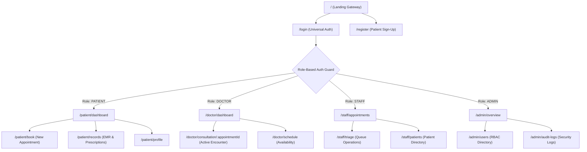

# UX App Flow & Interaction Specifications
## Project: CarePulse – Enterprise Hospital Management System (HMS)

**Document Version:** 1.0.0  
**Role:** Senior UX Strategist  
**Target Audience:** Frontend Engineers & AI Coding Agents  
**Scope:** Complete screen-by-screen navigation paths, user flows, UI component states, edge cases, and interaction specifications.

---

## 1. Information Architecture & Global Routing Matrix



### 1.1 Route Authentication & Guard Rules

| Route Path | Allowed Roles | Unauthenticated Redirect | Unauthorized (403) Handling |
| :--- | :--- | :--- | :--- |
| `/` | Public | N/A | N/A |
| `/login` | Public (Redirect if authenticated) | N/A | Route to appropriate role dashboard |
| `/register` | Public (Patient registration only) | N/A | Route to `/patient/dashboard` |
| `/patient/*` | `PATIENT` | Redirect to `/login?redirect=/patient/*` | Render `<ForbiddenView returnPath="/" />` |
| `/doctor/*` | `DOCTOR` | Redirect to `/login?redirect=/doctor/*` | Render `<ForbiddenView returnPath="/" />` |
| `/staff/*` | `STAFF`, `ADMIN` | Redirect to `/login?redirect=/staff/*` | Render `<ForbiddenView returnPath="/" />` |
| `/admin/*` | `ADMIN` | Redirect to `/login?redirect=/admin/*` | Render `<ForbiddenView returnPath="/" />` |

---

## 2. Global Design System & Component States Standard

### 2.1 Standard Button Interaction States

Every interactive button in the system must conform to these deterministic states:
* **Default:** Elevation-1, distinct background, high contrast text, cursor pointer.
* **Hover:** $+8\%$ luminance, smooth transform `translateY(-1px)`.
* **Active (Click):** Scale `0.98`, shadow collapse.
* **Loading:** Disabled pointer events, spinner replaces icon/text, button retains exact fixed dimensions to prevent layout shifts.
* **Disabled:** Opacity `0.45`, cursor `not-allowed`, no hover or focus effects.

### 2.2 Global Feedback Patterns
* **Success Toast:** Slides in from top-right (`duration: 3500ms`), green accent `#10B981`, checkmark icon, clear dismiss `×`.
* **Error Toast:** Slides in from top-right (`duration: 5000ms`), red accent `#EF4444`, alert circle icon, action retry button when applicable.
* **Modal Overlay:** Backdrop `#0f172a` with `backdrop-filter: blur(4px)`, closes on `Esc` key and backdrop click (unless dirty form active).
* **Optimistic Update:** Immediate client-side render; if local Express API fails within 3000ms, state snaps back and fires Error Toast.

---

## 3. Detailed Screen Specifications

---

### Screen 1.0: Public Gateway / Landing Page (`/`)

#### 1.0.1 Visual Layout & Purpose
The public welcome portal for hospital information, quick triage, and direct authentication entry points.
* **Top Navigation Bar:** Hospital Logo, "Our Specialists", "Emergency Hotline", "Sign In", "Book Appointment" (CTA).
* **Hero Banner:** Quick role chooser (Patient Portal, Doctor Login, Staff Desk).
* **Live Emergency Status:** Triage contact details, local hospital hours.

#### 1.0.2 Interactive Elements & Behaviors
* **`#btn-patient-login`:** Routes to `/login?role=patient`.
* **`#btn-doctor-login`:** Routes to `/login?role=doctor`.
* **`#btn-staff-login`:** Routes to `/login?role=staff`.
* **`#btn-book-now`:**
  * If logged in as patient $\to$ redirects to `/patient/book`.
  * If unauthenticated $\to$ redirects to `/login?redirect=/patient/book`.

---

### Screen 1.1: Unified Authentication Screen (`/login`)

#### 1.1.1 Visual Layout & Form Components
Centered glassmorphism auth card with role indicator pills:
* Role Selector Tabs: `[Patient]`, `[Doctor]`, `[Staff/Reception]`, `[Admin]`.
* Input 1: `#input-email` (type: email, auto-focus).
* Input 2: `#input-password` (type: password, with reveal/hide eye toggle button `#btn-toggle-pwd`).
* Checkbox: `#chk-remember` ("Keep me logged in locally").
* Button: `#btn-submit-login` ("Sign In to Portal").
* Sub-link: "New Patient? Create an account" (`#link-register`) $\to$ routes to `/register`.

#### 1.1.2 Validation & Form States
* **Client-Side Validation:**
  * Email must match valid email regex. Inline error: `"Please enter a valid hospital email or identifier"`.
  * Password cannot be blank. Inline error: `"Password is required"`.
* **Loading State:** Button displays `<Spinner size="sm" /> Signing In...`; inputs disabled.
* **Success State:**
  * JWT and role stored in memory/local storage.
  * Green notification toast: `"Welcome back, Dr. Rajesh"`.
  * Immediate redirect to role target dashboard.
* **Error State:**
  * `401 Unauthorized` $\to$ Inline banner above inputs: `"Invalid email or password. Please verify your credentials."`.
  * Input fields shake briefly (`animation: shake 0.3s`).
  * Password field cleared; cursor auto-focuses back on `#input-password`.

---

### Screen 1.2: Patient Self-Registration (`/register`)

#### 1.2.1 Form Components
* Inputs: Full Name (`#reg-name`), Email (`#reg-email`), Phone (`#reg-phone`), Date of Birth (`#reg-dob`), Blood Group dropdown (`#reg-blood-group`), Password (`#reg-password`), Confirm Password (`#reg-confirm-password`).
* Button: `#btn-submit-register` ("Complete Registration").

#### 1.2.2 States & Edge Cases
* **Password Mismatch:** Inline error below `#reg-confirm-password`: `"Passwords do not match"`.
* **Duplicate Email (`409 Conflict`):** Inline banner: `"An account with this email already exists. Sign in instead."` with clickable link.
* **Success State:** Auto-logs in the user, saves token, and forwards to `/patient/dashboard` with welcoming walkthrough toast.

---

### Screen 2.0: Patient Portal – Main Dashboard (`/patient/dashboard`)

#### 2.0.1 Visual Layout
```text
+-------------------------------------------------------------------------+
| [CarePulse Logo]      [Upcoming: Dr. Rajesh @ 10:00 AM]    [User: Sarah v]|
+-------------------+-----------------------------------------------------+
| [Dashboard]       | Welcome back, Sarah                                 |
| [Book Slot]       | +--------------------+ +--------------------------+ |
| [Medical Records] | | Next Appointment   | | Recent Prescriptions     | |
| [My Prescriptions]| | Dr. Rajesh (Cardio)| | Amlodipine 5mg (Active)  | |
| [Profile]         | | Oct 15, 09:30 AM   | | Prescribed: Oct 02       | |
|                   | | [Reschedule] [Cancel]| [Download Rx PDF]        | |
|                   | +--------------------+ +--------------------------+ |
|                   |                                                     |
|                   | Past Consultations History                         |
|                   | [Search table...]                                   |
|                   | (Table: Date | Doctor | Department | Action)        |
+-------------------+-----------------------------------------------------+
```

#### 2.0.2 Action & Button Behaviors
* **`#btn-book-appointment-cta`:** Direct button in top banner $\to$ routes to `/patient/book`.
* **`#btn-cancel-appt`:** Triggers confirmation modal `#modal-cancel-appt`:
  * Modal CTA `#btn-confirm-cancel` $\to$ Sends `PATCH /api/v1/appointments/:id/status` `{ status: 'CANCELLED' }`.
  * Success Toast: `"Appointment successfully cancelled"`.
  * Appointment card animates out (`fade-out 200ms`).
* **Empty State (No Appointments):**
  * Container with gentle calendar illustration.
  * Headline: `"No upcoming appointments"`.
  * Body: `"Schedule your routine check-up or consult with our on-duty specialists."`.
  * Primary Button: `#btn-empty-book` $\to$ routes to `/patient/book`.

---

### Screen 2.1: Patient Portal – Book Appointment (`/patient/book`)

#### 2.1.1 Step-by-Step Booking Stepper
* **Step 1: Department & Specialist Selection:**
  * Dropdown: Department (`Cardiology`, `Orthopedics`, `General Medicine`, `Pediatrics`).
  * Doctor Cards Grid: Displays doctor photo, name, room number, next available slot badge.
  * Action: Selecting doctor highlights card with primary border and advances to Step 2.
* **Step 2: Date & Available Slot Picker:**
  * Mini Calendar: Select date (past dates disabled; doctor rest days disabled).
  * Time Slot Chips: Grid of pills (`09:00 AM`, `09:30 AM`, `10:00 AM`, etc.).
  * Slot status: Green (Available), Grey/Strikethrough (Booked), Blue (Selected).
* **Step 3: Consultation Reason & Review:**
  * Textarea: `#txt-consult-reason` (Placeholder: `"Briefly describe your symptoms or reason for visit..."`).
  * Summary Card: Selected Doctor, Department, Date, Time, Room.
  * Button: `#btn-confirm-booking` ("Confirm Appointment").

#### 2.1.2 States & Edge Cases
* **Slot Collision (Already Taken):** If another patient or receptionist booked the slot concurrently $\to$ `409 Conflict`:
  * Error Toast: `"This time slot was just booked by another patient. Please select another slot."`.
  * Slot turns grey, selection clears, user prompted to pick another pill.
* **Success State:**
  * Screen transitions to Booking Success Confirmation.
  * Displays Confirmation Badge, Appointment Reference ID, and button `"Go to Dashboard"` (`#btn-success-dash`).

---

### Screen 2.2: Patient Portal – Medical Records & Prescriptions (`/patient/records`)

#### 2.2.1 Visual Layout & Components
* Split View:
  * Left Panel: Longitudinal timeline of visits (sorted newest first).
  * Right Panel: Encounter detail view (Vitals summary, Symptoms recorded, Diagnoses, Prescriptions list).
* Button: `#btn-download-rx-pdf` ("Export Prescription PDF"). Generates formatted on-device print/PDF dialogue.

#### 2.2.2 Empty State
* Headline: `"No medical records on file yet"`.
* Body: `"Medical records and prescriptions will appear here automatically following your consultations."`.

---

### Screen 3.0: Doctor Portal – Clinic Dashboard & Live Queue (`/doctor/dashboard`)

#### 3.0.1 Visual Layout
```text
+-----------------------------------------------------------------------------+
| [CarePulse HMS - Doctor]   Dr. Rajesh Kumar (Cardiology)      [Live Queue: 6]|
+-----------------------------------------------------------------------------+
| Active Patient in Room:                                                     |
| +-------------------------------------------------------------------------+ |
| | PATIENT: John Doe (42M) | Blood: B+ | BP: 130/85 | Status: IN CONSULTATION| |
| | [Open Clinical Encounter / EMR Form]             [Mark Completed]       | |
| +-------------------------------------------------------------------------+ |
|                                                                             |
| Today's Patient Queue (Oct 15, 2026)             [Search Queue: _________]  |
| +----+---------+---------------+--------+----------------+----------------+ |
| | #  | Time    | Patient Name  | Age/Sex| Status         | Action         | |
| +----+---------+---------------+--------+----------------+----------------+ |
| | 1  | 09:00 AM| John Doe      | 42 / M | IN CONSULTATION| [Resume Chart] | |
| | 2  | 09:30 AM| Jane Smith    | 31 / F | CHECKED IN     | [Call Next]    | |
| | 3  | 10:00 AM| Robert Frost  | 55 / M | SCHEDULED      | [Review File]  | |
| +----+---------+---------------+--------+----------------+----------------+ |
+-----------------------------------------------------------------------------+
```

#### 3.0.2 Action & Button Behaviors (Optimistic Concurrency Engine)
* **`#btn-call-next`:**
  * Advances patient status to `IN_CONSULTATION`.
  * Automatically switches the top "Active Patient" banner.
  * Custom hook optimistic state update reflects instantly ($< 20\text{ms}$).
  * Opens the Clinical Encounter Drawer (`/doctor/consultation/:appointmentId`).
* **`#btn-mark-completed`:**
  * Confirmation trigger: Ensures prescriptions/notes are saved.
  * Status updates to `COMPLETED`.
  * Next patient in queue automatically prompted.
* **Empty State (No patients today):**
  * Icon: Coffee mug / Stethoscope.
  * Text: `"Your consultation queue is clear for today"`.
  * Subtext: `"New walk-ins or scheduled bookings will appear here in real-time."`.

---

### Screen 3.1: Doctor Portal – Clinical Encounter & EMR Drawer (`/doctor/consultation/:appointmentId`)

#### 3.1.1 Drawer & Form Structure
Slide-over full-height workspace with two tabs:
* **Tab A: Patient Longitudinal History:**
  * Pulls previous diagnoses, vitals trends, and drug allergies in $< 150\text{ms}$ using indexed MongoDB projections.
  * Red Allergy Alert Tag if allergies recorded (e.g., `⚠️ ALLERGIC TO PENICILLIN`).
* **Tab B: Active Consultation Entry Form:**
  * Section 1: Vitals Grid (BP `#vit-bp`, Pulse `#vit-pulse`, Temp `#vit-temp`, Weight `#vit-weight`).
  * Section 2: Clinical Symptoms & Observations (multi-line textarea `#diag-symptoms`).
  * Section 3: Diagnosis (input `#diag-title`).
  * Section 4: E-Prescription Builder:
    * Repeatable rows: Medication Name `#rx-med-0`, Dosage `#rx-dose-0`, Frequency dropdown `#rx-freq-0` (`Once daily`, `Twice daily`, `TDS`, `PRN`), Duration `#rx-dur-0`.
    * Button `#btn-add-medicine-row` ("+ Add Medication").
    * Button `#btn-remove-row-x` (Removes row).

#### 3.1.2 Buttons & Save Behavior
* **`#btn-save-encounter`:**
  * Validates that at least Diagnosis or Observation is populated.
  * Dispatches `POST /api/v1/records`.
  * Shows Success Toast: `"Clinical encounter saved successfully"`.
  * Closes drawer and prompts to mark appointment as `COMPLETED`.
* **`#btn-discard-draft`:** Prompts confirmation dialog: `"Discard unsaved changes for this encounter?"`.

---

### Screen 4.0: Staff / Receptionist Desk – Master Appointment Grid & Triage (`/staff/appointments`)

#### 4.0.1 Visual Layout & High-Throughput Matrix
Designed specifically for front-desk triage handling **100+ concurrent state mutations**:
* Filter Bar: Doctor Filter dropdown, Department Filter, Date Selector (defaults to Today), Status Pills (`All`, `Scheduled`, `Checked In`, `Completed`, `Cancelled`).
* Search Box (`#search-patient-global`): Debounced (200ms) search across patient name, phone number, and appointment ID.
* High-Performance Grid: Virtualized table rows rendering without layout shifts.

#### 4.0.2 Reception Action Buttons
* **`#btn-check-in-toggle`:**
  * Single-click toggle from `SCHEDULED` $\to$ `CHECKED_IN`.
  * Pill transitions from Grey to Vivid Teal.
  * Fires optimistic UI update; doctor queue updates instantaneously on next poll/read.
* **`#btn-quick-walkin-book`:** Opens Quick Booking Modal `#modal-quick-book`:
  * Select or register walk-in patient.
  * Pick available doctor slot.
  * Click Confirm $\to$ Immediately adds row to top of grid.

---

### Screen 4.1: Staff / Receptionist Desk – Patient Directory (`/staff/patients`)

#### 4.1.1 Components & Search
* Search Bar: By Full Name or Phone Number.
* Action Button: `#btn-create-new-patient` $\to$ Opens demographic registration modal.
* Table: Patient ID, Full Name, Phone, Age/Gender, Blood Group, Last Visit, Action: `[Book Slot]`, `[View Profile]`.

---

### Screen 5.0: Admin Console – User & Staff Directory (`/admin/users`)

#### 5.0.1 Visual Layout & Capabilities
* Role Segregated Tabs: `[Doctors]`, `[Staff Members]`, `[Patients]`, `[Admins]`.
* Table Columns: User Email, Role Badge, Full Name, Department/Specialization, Account Status (`Active` / `Disabled`), Created Date, Actions: `[Edit Role]`, `[Reset Password]`, `[Toggle Status]`.
* Button `#btn-add-provider` ("+ Add Doctor / Staff"):
  * Form inputs: Full Name, Email, Temporary Password, Role, Specialization, Room Number.
  * Submits to `POST /api/v1/auth/register` with role specification.

---

### Screen 5.1: Admin Console – Hospital Overview & Metrics (`/admin/overview`)

#### 5.1.1 Analytics & Latency Telemetry Cards
* Card 1: **Today's Patient Throughput** (Total Consultations, Checked In, In Progress).
* Card 2: **Doctor Availability Index** (Active on duty vs. off shift).
* Card 3: **System Latency Monitor** (Average endpoint latency benchmark $\approx 110\text{ms}$, cache hits).
* Card 4: **RBAC Security Audit Widget** (Recent log-ins, zero access violations flag).

---

### Screen 6.0: Global Fallbacks & Edge Case Screens

#### 6.0.1 404 Not Found Screen (`*`)
* Visual: Clean medical cross illustration with broken pulse line.
* Text: `"404 - Page Not Found"`.
* Subtext: `"The requested clinical or administrative portal page does not exist."`.
* Button: `#btn-404-home` ("Return to Home / Dashboard").

#### 6.0.2 403 Forbidden Access Screen
* Visual: Shield lock badge with amber/red alert ring.
* Text: `"403 - Restricted Area"`.
* Subtext: `"Your account role does not have authorization to access this department or patient file."`.
* Button: `#btn-403-back` ("Return to Your Authorized Portal").

#### 6.0.3 Offline / Connection Lost State (Local Server Down)
* Top floating banner: `"⚠️ Unable to connect to local CarePulse API server at localhost:5000. Please ensure the backend service is running."`.
* Button: `#btn-retry-connection` ("Retry Connection").

---

## 4. Complete Screen Navigation Flow Summary Table

| Source Screen | Trigger Event / Button | Destination Screen | Pre-conditions / Constraints |
| :--- | :--- | :--- | :--- |
| **Landing (`/`)** | Click "Sign In" | `/login` | None |
| **Landing (`/`)** | Click "New Patient Register" | `/register` | None |
| **Login (`/login`)** | Successful login as Patient | `/patient/dashboard` | Credentials verified via bcrypt |
| **Login (`/login`)** | Successful login as Doctor | `/doctor/dashboard` | Credentials verified via bcrypt |
| **Login (`/login`)** | Successful login as Staff | `/staff/appointments` | Credentials verified via bcrypt |
| **Login (`/login`)** | Successful login as Admin | `/admin/overview` | Credentials verified via bcrypt |
| **Patient Dash** | Click "Book Appointment" | `/patient/book` | Authenticated as `PATIENT` |
| **Patient Dash** | Click "Medical Records" | `/patient/records` | Authenticated as `PATIENT` |
| **Doctor Dash** | Click "Call Next" / "Open File" | `/doctor/consultation/:id`| Active appointment exists |
| **Doctor Consult**| Click "Save & Complete" | `/doctor/dashboard` | Diagnosis entered; updates state |
| **Staff Dash** | Click "Check In" pill | Stays on `/staff/appointments` | Optimistic status update |
| **Staff Dash** | Click "Patient Directory" | `/staff/patients` | Authenticated as `STAFF` or `ADMIN`|
| **Any Screen** | Click "Log Out" | `/login` | Clears JWT & context state |
