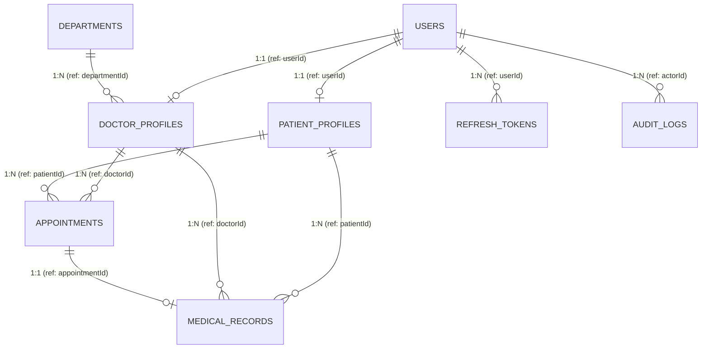
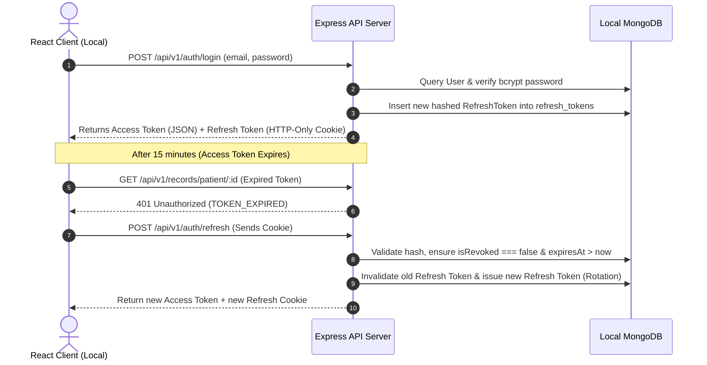

# Complete Backend Database Schema & Data Architecture
## Project: CarePulse – Enterprise Hospital Management System (HMS)

**Document Version:** 1.0.0  
**Role:** Senior Principal Backend Engineer  
**Database Engine:** MongoDB Community Server (Localhost: `mongodb://127.0.0.1:27017/carepulse_hms`)  
**Data Modeling Framework:** Mongoose ODM (Node.js / Express.js)  
**Security & Access Paradigm:** Zero-Cloud, Strict Local RBAC, Object-Level Data Ownership  

---

## 1. Entity-Relationship (ER) Architecture



---

## 2. Collection Schemas, Field Types & Validation

### 2.1 Collection: `users`
Stores user identities, hashed credentials, core role declarations, and account status flags.

| Field Name | Data Type | Key / Constraint | Required | Default | Description |
| :--- | :--- | :--- | :---: | :---: | :--- |
| `_id` | `ObjectId` | **PK** (Auto) | Yes | Auto | Unique system identifier |
| `email` | `String` | **Unique Index**, Lowercase | Yes | - | Login credential (RFC 5322 regex) |
| `passwordHash` | `String` | Bcrypt Hash ($12$ rounds) | Yes | - | Hashed secret; excluded from projections |
| `role` | `String` | Enum: `PATIENT`, `DOCTOR`, `STAFF`, `ADMIN` | Yes | `PATIENT` | Primary role for RBAC enforcement |
| `isActive` | `Boolean` | Index | Yes | `true` | Soft deactivation flag |
| `lastLoginAt` | `Date` | - | No | `null` | Timestamp of latest authenticated session |
| `createdAt` | `Date` | Timestamp | Yes | `Date.now` | Account creation timestamp |
| `updatedAt` | `Date` | Timestamp | Yes | `Date.now` | Account modification timestamp |

#### Production Mongoose Definition:
```javascript
const userSchema = new mongoose.Schema({
  email: {
    type: String,
    required: [true, 'Email is required'],
    unique: true,
    lowercase: true,
    trim: true,
    match: [/^\w+([.-]?\w+)*@\w+([.-]?\w+)*(\.\w{2,3})+$/, 'Invalid email address']
  },
  passwordHash: {
    type: String,
    required: [true, 'Password hash is required'],
    select: false // Never return in default queries
  },
  role: {
    type: String,
    enum: ['PATIENT', 'DOCTOR', 'STAFF', 'ADMIN'],
    default: 'PATIENT',
    required: true,
    index: true
  },
  isActive: {
    type: Boolean,
    default: true,
    index: true
  },
  lastLoginAt: {
    type: Date,
    default: null
  }
}, { timestamps: true });
```

---

### 2.2 Collection: `patient_profiles`
Holds patient demographics, contact records, emergency details, and clinical identification numbers.

| Field Name | Data Type | Key / Constraint | Required | Default | Description |
| :--- | :--- | :--- | :---: | :---: | :--- |
| `_id` | `ObjectId` | **PK** (Auto) | Yes | Auto | Unique profile ID |
| `userId` | `ObjectId` | **FK** $\to$ `users._id`, **Unique** | Yes | - | 1:1 binding to user identity |
| `mrn` | `String` | **Unique Index** | Yes | Auto | Medical Record Number (e.g. `MRN-2026-0041`) |
| `fullName` | `String` | Text Index | Yes | - | Patient full legal name |
| `phone` | `String` | Index, Trim | Yes | - | Primary contact phone |
| `dateOfBirth` | `Date` | - | Yes | - | DOB for age calculation |
| `gender` | `String` | Enum: `MALE`, `FEMALE`, `OTHER` | Yes | - | Biological/preferred gender |
| `bloodGroup` | `String` | Enum: `A+`, `A-`, `B+`, `B-`, `AB+`, `AB-`, `O+`, `O-` | No | `null` | Blood type |
| `allergies` | `[String]` | Array of Strings | No | `[]` | Documented drug & food allergies |
| `emergencyContact` | `Subdocument` | Schema | No | - | Emergency contact info |
| ↳ `name` | `String` | - | No | `null` | Contact person name |
| ↳ `relationship` | `String` | - | No | `null` | e.g. Spouse, Parent, Sibling |
| ↳ `phone` | `String` | - | No | `null` | Emergency phone number |
| `address` | `Subdocument` | Schema | No | - | Street, city, state, zipCode |
| `createdAt` / `updatedAt` | `Date` | Timestamps | Yes | `Date.now` | Record modification tracker |

---

### 2.3 Collection: `doctor_profiles`
Stores provider professional information, departmental assignments, consultation fee, and slot schedules.

| Field Name | Data Type | Key / Constraint | Required | Default | Description |
| :--- | :--- | :--- | :---: | :---: | :--- |
| `_id` | `ObjectId` | **PK** (Auto) | Yes | Auto | Unique provider ID |
| `userId` | `ObjectId` | **FK** $\to$ `users._id`, **Unique** | Yes | - | 1:1 binding to user identity |
| `fullName` | `String` | Text Index | Yes | - | Formatted name (e.g. Dr. Rajesh Kumar) |
| `licenseNumber`| `String` | **Unique Index** | Yes | - | Medical Council Registration No. |
| `department` | `String` | Index | Yes | - | e.g. `Cardiology`, `Pediatrics`, `Neurology` |
| `specialization`| `String` | - | Yes | - | e.g. `Interventional Cardiologist` |
| `roomNumber` | `String` | - | Yes | - | Clinic consultation room (e.g. `Room 304`) |
| `workingDays` | `[String]` | Array: `['MON', 'TUE', ...]` | Yes | `['MON'-'FRI']` | Available clinic days |
| `slotDuration` | `Number` | Minutes | Yes | `30` | Duration per appointment slot |
| `workingHours` | `Subdocument` | - | Yes | - | Start time and end time |
| ↳ `startTime` | `String` | HH:mm format | Yes | `"09:00"` | Clinic opening time |
| ↳ `endTime` | `String` | HH:mm format | Yes | `"17:00"` | Clinic closing time |
| `isAvailable` | `Boolean` | Index | Yes | `true` | Doctor currently on duty |
| `createdAt` / `updatedAt` | `Date` | Timestamps | Yes | `Date.now` | Audit tracker |

---

### 2.4 Collection: `appointments`
Coordinates the live consultation queue, slot bookings, status lifecycles, and front-desk check-ins.

| Field Name | Data Type | Key / Constraint | Required | Default | Description |
| :--- | :--- | :--- | :---: | :---: | :--- |
| `_id` | `ObjectId` | **PK** (Auto) | Yes | Auto | Unique appointment identifier |
| `patientId` | `ObjectId` | **FK** $\to$ `patient_profiles._id` | Yes | - | Reference to patient |
| `doctorId` | `ObjectId` | **FK** $\to$ `doctor_profiles._id` | Yes | - | Reference to attending doctor |
| `appointmentDate` | `Date` | Index (Truncated to midnight) | Yes | - | Day of consultation |
| `timeSlot` | `String` | HH:mm format | Yes | - | Time slot (e.g. `"10:30"`) |
| `status` | `String` | Enum (see below) | Yes | `SCHEDULED` | Active lifecycle stage |
| `reason` | `String` | Max 500 chars | No | `null` | Reason for visit / primary symptom |
| `queueNumber` | `Number` | Daily serial index | Yes | `1` | Token number for waiting room display |
| `checkInTime` | `Date` | - | No | `null` | Timestamp when marked `CHECKED_IN` |
| `completedTime`| `Date` | - | No | `null` | Timestamp when marked `COMPLETED` |
| `cancelledReason`| `String`| - | No | `null` | Reason if status is `CANCELLED` |
| `createdAt` / `updatedAt` | `Date` | Timestamps | Yes | `Date.now` | Audit tracker |

#### Appointment Status Enum Values:
* `SCHEDULED`: Slot reserved by patient or front-desk.
* `CHECKED_IN`: Patient arrived at reception, waiting in triage.
* `IN_CONSULTATION`: Patient currently in room with physician.
* `COMPLETED`: Clinical encounter finalized, notes recorded.
* `CANCELLED`: Appointment cancelled prior to consultation.
* `NO_SHOW`: Slot elapsed without check-in.

---

### 2.5 Collection: `medical_records` (EMR Encounters)
Contains patient clinical encounters, longitudinal vitals, diagnoses, and structured e-prescriptions.

| Field Name | Data Type | Key / Constraint | Required | Default | Description |
| :--- | :--- | :--- | :---: | :---: | :--- |
| `_id` | `ObjectId` | **PK** (Auto) | Yes | Auto | Unique medical record ID |
| `patientId` | `ObjectId` | **FK** $\to$ `patient_profiles._id` | Yes | - | Patient ownership reference |
| `doctorId` | `ObjectId` | **FK** $\to$ `doctor_profiles._id` | Yes | - | Authoring physician reference |
| `appointmentId`| `ObjectId` | **FK** $\to$ `appointments._id`, **Unique** | Yes | - | 1:1 link to appointment encounter |
| `recordDate` | `Date` | Index | Yes | `Date.now` | Timestamp of encounter |
| `vitals` | `Subdocument` | Embedded Document | Yes | - | Objective biometric measurements |
| ↳ `bloodPressure`| `String` | e.g. `"120/80"` | No | `null` | Systolic / Diastolic mmHg |
| ↳ `pulseRate` | `Number` | bpm | No | `null` | Heart rate |
| ↳ `temperature`| `Number` | Fahrenheit | No | `null` | Body temperature |
| ↳ `weightKg` | `Number` | Kilograms | No | `null` | Body weight |
| ↳ `spO2` | `Number` | Percentage | No | `null` | Blood oxygen saturation |
| `symptoms` | `[String]` | Array of strings | No | `[]` | Reported subjective symptoms |
| `diagnosis` | `String` | Index | Yes | - | Primary clinical diagnosis |
| `clinicalNotes`| `String` | Long-form markdown/text | No | `""` | Detailed examination notes |
| `prescriptions` | `[Subdocument]`| Array of e-prescriptions | No | `[]` | Standardized medications list |
| ↳ `medicineName`| `String` | Required | Yes | - | Brand/generic drug name |
| ↳ `dosage` | `String` | e.g. `"500mg"`, `"5ml"` | Yes | - | Strength / dose |
| ↳ `frequency` | `String` | Enum: `OD`, `BD`, `TDS`, `QID`, `PRN` | Yes | `"OD"` | Administration frequency |
| ↳ `duration` | `String` | e.g. `"5 days"`, `"1 month"`| Yes | - | Treatment course length |
| ↳ `instructions`| `String`| e.g. `"Take post food"` | No | `""` | Patient dosage instructions |
| `createdAt` / `updatedAt` | `Date` | Timestamps | Yes | `Date.now` | Immutable clinical record logs |

---

### 2.6 Collection: `refresh_tokens` (Local Session Store)
Maintains local on-device session state and handles secure JWT refresh token rotation without external session daemons (like Redis).

| Field Name | Data Type | Key / Constraint | Required | Default | Description |
| :--- | :--- | :--- | :---: | :---: | :--- |
| `_id` | `ObjectId` | **PK** (Auto) | Yes | Auto | Unique token record ID |
| `userId` | `ObjectId` | **FK** $\to$ `users._id` | Yes | - | Bound user identity |
| `tokenHash` | `String` | **Unique Index** | Yes | - | SHA-256 hash of issued refresh token |
| `deviceInfo` | `String` | User-agent string | No | `null` | Local client device signature |
| `isRevoked` | `Boolean` | Index | Yes | `false` | Immediate token revocation flag |
| `expiresAt` | `Date` | **TTL Index** (`expireAfterSeconds: 0`)| Yes | - | Auto-cleans expired sessions in MongoDB |
| `createdAt` | `Date` | Timestamp | Yes | `Date.now` | Issuance timestamp |

---

### 2.7 Collection: `audit_logs` (Compliance & Traceability)
Tracks high-sensitivity actions (viewing clinical records, altering appointments, admin privilege grants) for clinical audit trails.

| Field Name | Data Type | Key / Constraint | Required | Default | Description |
| :--- | :--- | :--- | :---: | :---: | :--- |
| `_id` | `ObjectId` | **PK** (Auto) | Yes | Auto | Unique log entry ID |
| `actorId` | `ObjectId` | **FK** $\to$ `users._id` | Yes | - | User performing action |
| `actorRole` | `String` | `PATIENT`, `DOCTOR`, `STAFF`, `ADMIN` | Yes | - | Role at time of action |
| `action` | `String` | Index (e.g. `RECORD_VIEW`, `APPOINTMENT_CANCEL`)| Yes | - | Verb describing mutation/read |
| `resourceType` | `String` | `MEDICAL_RECORD`, `APPOINTMENT`, `USER` | Yes | - | Target collection/domain |
| `resourceId` | `ObjectId` | Resource Primary Key | Yes | - | Target document identifier |
| `ipAddress` | `String` | `127.0.0.1` | Yes | `"127.0.0.1"`| Request origin |
| `createdAt` | `Date` | **TTL Index** (Retained for 90 days) | Yes | `Date.now` | Event timestamp |

---

## 3. High-Performance Indexing Strategy (Achieving the 35% Latency Drop)

To consistently deliver sub-150ms query responses across high-load clinical tables, the database requires specific compound, sparse, and TTL indexing:

```javascript
// ==========================================
// 1. APPOINTMENTS COLLECTION INDEXES
// ==========================================

// Prevents double-booking collision while instantly resolving doctor slot availability
appointmentSchema.index(
  { doctorId: 1, appointmentDate: 1, timeSlot: 1 },
  { unique: true, name: 'idx_doctor_slot_unique' }
);

// High-speed retrieval for Doctor's Daily Queue (Doctor Dashboard load in < 40ms)
appointmentSchema.index(
  { doctorId: 1, appointmentDate: 1, status: 1 },
  { name: 'idx_doctor_daily_queue' }
);

// High-speed retrieval for Patient's appointment history
appointmentSchema.index(
  { patientId: 1, appointmentDate: -1 },
  { name: 'idx_patient_appointment_history' }
);

// Front-desk triage filter index (Date + Status query)
appointmentSchema.index(
  { appointmentDate: 1, status: 1 },
  { name: 'idx_staff_daily_triage' }
);


// ==========================================
// 2. MEDICAL RECORDS COLLECTION INDEXES
// ==========================================

// Longitudinal Patient Clinical History Index (Instant EMR drawer load in < 50ms)
medicalRecordSchema.index(
  { patientId: 1, recordDate: -1 },
  { name: 'idx_patient_emr_timeline' }
);

// Enforces strict 1:1 relationship between encounter & appointment
medicalRecordSchema.index(
  { appointmentId: 1 },
  { unique: true, name: 'idx_appointment_emr_unique' }
);


// ==========================================
// 3. PATIENT PROFILES INDEXES
// ==========================================

// Fast receptionist lookup by phone or Medical Record Number
patientProfileSchema.index({ phone: 1 }, { name: 'idx_patient_phone' });
patientProfileSchema.index({ mrn: 1 }, { unique: true, name: 'idx_patient_mrn' });
patientProfileSchema.index({ fullName: 'text' }, { name: 'idx_patient_text_search' });


// ==========================================
// 4. REFRESH TOKENS TTL INDEX
// ==========================================

// MongoDB native daemon automatically purges expired tokens from storage
refreshTokenSchema.index(
  { expiresAt: 1 },
  { expireAfterSeconds: 0, name: 'idx_token_auto_purge_ttl' }
);
```

---

## 4. Authentication, Session Handling & Token Lifecycles

### 4.1 Token Structure & Payload Anatomy

#### Access Token (JWT):
* **Format:** HMAC SHA-256 (`HS256`)
* **Lifespan:** 15 minutes (`15m`)
* **Transmission:** HTTP Header `Authorization: Bearer <token>`
* **Token Payload:**
```json
{
  "sub": "660c18d0f1b2c4e32049e01a",
  "email": "doctor.rajesh@carepulse.local",
  "role": "DOCTOR",
  "profileId": "660c18e5f1b2c4e32049e02f",
  "iat": 1791651600,
  "exp": 1791652500
}
```

#### Refresh Token:
* **Format:** Cryptographically secure 64-byte random hexadecimal string (`crypto.randomBytes(64).toString('hex')`)
* **Lifespan:** 7 days
* **Transmission:** HTTP-Only, SameSite=Strict cookie (`/api/v1/auth/refresh`)
* **Database Representation:** Only the SHA-256 hash of this token is stored in the `refresh_tokens` collection to prevent database breach token replay.

### 4.2 Token Rotation & Revocation Lifecycle



---

## 5. Granular Permissions & Data Ownership Rules

### 5.1 The 4 Pillars of Data Ownership

1. **Self-Ownership (Patients):**
   * A patient can only view their own demographics, their own appointments, and their own released medical records.
   * Query Rule Enforced in Code:
     ```javascript
     const filter = { patientId: req.user.profileId };
     ```
2. **Clinical Custody (Doctors):**
   * A doctor can read patient records for patients who have an active or past appointment assigned to them or their department.
   * Only the authoring doctor can create or update a clinical encounter (`medical_records`).
   * Doctors cannot access administrative user passwords, system settings, or unrelated staff metadata.
3. **Operational Scope (Front-Desk Staff):**
   * Staff can search patients, register walk-ins, and create, reschedule, or check-in appointments.
   * **Absolute Barrier:** Staff members have **zero read access** to clinical records (`medical_records` collection) or diagnostic notes.
4. **Administrative Governance (Admin):**
   * Admins can create and deactivate accounts, assign doctor departments, and review audit logs.
   * Admins have no clinical modification privileges over existing doctor diagnosis entries.

### 5.2 Server-Side Ownership Guard Middleware

```javascript
// middleware/ownershipGuard.js
const checkRecordOwnership = async (req, res, next) => {
  const { role, profileId } = req.user;
  const targetPatientId = req.params.patientId || req.body.patientId;

  // 1. Admin & Staff handling
  if (role === 'STAFF') {
    return res.status(403).json({
      success: false,
      message: 'Staff members are not authorized to view clinical medical records'
    });
  }

  // 2. Patient can only access their own profile
  if (role === 'PATIENT' && profileId.toString() !== targetPatientId.toString()) {
    return res.status(403).json({
      success: false,
      message: 'Access denied: You cannot view records belonging to other patients'
    });
  }

  // 3. Doctor access verification (Must have consultation relation or valid department credential)
  if (role === 'DOCTOR') {
    const hasEncounter = await Appointment.exists({
      doctorId: profileId,
      patientId: targetPatientId
    });
    if (!hasEncounter && role !== 'ADMIN') {
      return res.status(403).json({
        success: false,
        message: 'Clinical restriction: You are not an assigned physician for this patient'
      });
    }
  }

  next();
};
```

---

## 6. Complete CRUD & Data Lifecycle Matrix

| Collection | Create (`POST`) | Read (`GET`) | Update (`PATCH`/`PUT`) | Delete (`DELETE`) |
| :--- | :--- | :--- | :--- | :--- |
| `users` | Public (Patients) / Admin (Staff) | Self / Admin | Self (Password/Email) | Soft Delete (`isActive: false`) by Admin only |
| `patient_profiles` | Self (Register) / Staff (Walk-in) | Self / Staff / Doctor | Self / Staff (Demographics) | Restricted / Archival only |
| `doctor_profiles` | Admin only | Public / All Authenticated | Self (Availability) / Admin | Admin only |
| `appointments` | Patient (Self) / Staff (Any) | Patient (Self) / Doctor (Assigned) / Staff (All) | Patient (Cancel) / Staff (Reschedule/Check-in) / Doctor (Complete) | Soft Cancel (`status: CANCELLED`) |
| `medical_records`| Doctor only (During consultation)| Patient (Self) / Doctor (Assigned) | Authoring Doctor only | **Immutable** (No physical deletes permitted) |
| `audit_logs` | System internal trigger only | Admin only | **None** (Append-only) | Auto-purged via MongoDB TTL (90 days) |
