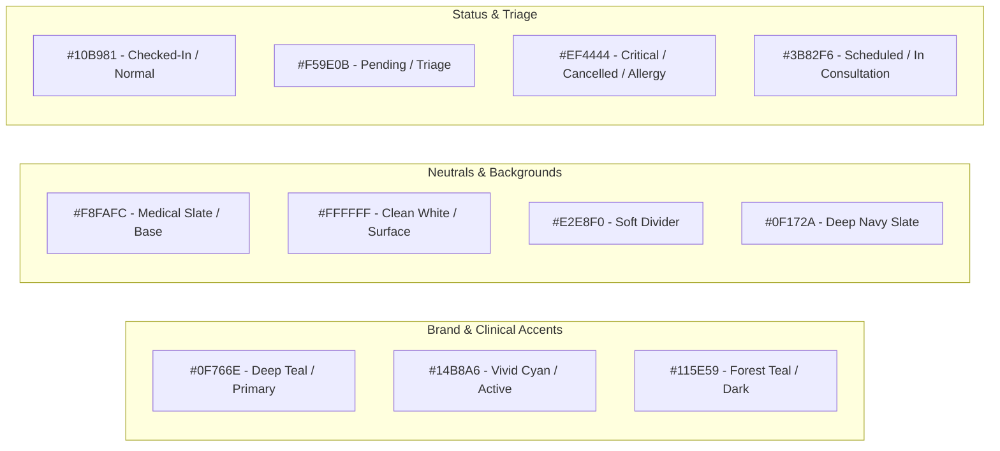

# UI/UX Design Brief & Visual Design System
## Project: CarePulse – Enterprise Hospital Management System (HMS)

**Document Version:** 1.0.0  
**Role:** Senior Lead UI/UX Designer  
**Target Audience:** Frontend Engineers & AI App Builders  
**Design Philosophy:** "Clinical Precision Meets Human Warmth" – High-contrast, lightning-fast, accessible, and clutter-free interface engineered for stressful clinical environments.

---

## 1. Design Style & Visual Direction

### 1.1 Core Aesthetic: "Modern Clinical Neo-Minimalism"
Hospital and clinical software is notoriously clunky, visually chaotic, and exhausting to use. CarePulse redefines this with:
* **Crisp Visual Hierarchy:** High contrast ratios (exceeding WCAG 2.1 AAA for vital data) with generous whitespace to prevent cognitive fatigue.
* **Subtle Frosted Glass Accents:** Translucent overlay modals and sticky headers (`backdrop-filter: blur(12px)`) that maintain spatial grounding without distraction.
* **Micro-Elevation & Tactile Surface Levels:** 4 distinct surface tiers (Base, Card, Floating, Modal) using tailored ambient shadows instead of harsh dark borders.
* **Color as Function:** Color is reserved strictly for status cues, triage priorities, and primary navigation calls-to-action. Administrative chrome remains neutral and unobtrusive.

---

## 2. Design Tokens & Color Palette



### 2.1 Color Tokens Specification (Hex & HSL)

```css
:root {
  /* Brand / Primary Clinical Colors */
  --color-primary: #0F766E;          /* Teal-700: Professional clinical trust */
  --color-primary-hover: #115E59;    /* Teal-800: High-contrast hover */
  --color-primary-light: #CCFBF1;    /* Teal-100: Soft badge backgrounds */
  --color-primary-accent: #14B8A6;   /* Teal-500: Active indicators, pulse rings */

  /* Neutral Surface & Background Tokens */
  --color-bg-base: #F8FAFC;          /* Slate-50: Crisp, clean clinic backdrop */
  --color-surface-card: #FFFFFF;     /* Pure White: High-clarity elevated cards */
  --color-surface-hover: #F1F5F9;    /* Slate-100: Table row & list hover */
  --color-border-subtle: #E2E8F0;    /* Slate-200: Low-contrast structural dividers */
  --color-border-focus: #0F766E;     /* Focus outline ring */

  /* Text & Typography Contrast Tokens */
  --color-text-primary: #0F172A;     /* Slate-900: Pure readability (14.2:1 contrast) */
  --color-text-secondary: #475569;   /* Slate-600: Supporting labels and metadata */
  --color-text-muted: #94A3B8;       /* Slate-400: Placeholders & inactive icons */
  --color-text-inverse: #FFFFFF;     /* White text on dark/colored buttons */

  /* Semantic Clinical Status Cues */
  --status-scheduled-bg: #EFF6FF;   /* Blue-50 */
  --status-scheduled-text: #1D4ED8; /* Blue-700 */

  --status-checkedin-bg: #ECFDF5;   /* Emerald-50 */
  --status-checkedin-text: #047857; /* Emerald-700 */

  --status-inconsult-bg: #F5F3FF;   /* Purple-50 */
  --status-inconsult-text: #6D28D9; /* Purple-700 */

  --status-completed-bg: #F1F5F9;   /* Slate-100 */
  --status-completed-text: #334155; /* Slate-700 */

  --status-danger-bg: #FEF2F2;      /* Red-50: Allergy tags, cancellations */
  --status-danger-text: #B91C1C;    /* Red-700 */

  --status-warning-bg: #FFFBEB;     /* Amber-50: Urgent reminders */
  --status-warning-text: #B45309;   /* Amber-700 */
}
```

---

## 3. Typography Hierarchy & Rules

### 3.1 Primary Font Family
* **Font Family:** `'Plus Jakarta Sans'`, `'Inter'`, `-apple-system`, `BlinkMacSystemFont`, `sans-serif`.
* **Characteristics:** Open aperture, modern geometric neo-grotesque numerals (crucial for vital numbers, dosages, and times), excellent legibility at $11\text{px}$–$14\text{px}$.

```css
@import url('https://fonts.googleapis.com/css2?family=Plus+Jakarta+Sans:wght@400;500;600;700;800&display=swap');
```

### 3.2 Type Scale System

| Element | Size | Line Height | Weight | Letter Spacing | CSS Usage |
| :--- | :--- | :--- | :--- | :--- | :--- |
| **Display Title (H1)** | 32px (2.0rem) | 1.25 | 800 (ExtraBold) | -0.025em | Landing heroes, primary dashboard greets |
| **Section Title (H2)** | 24px (1.5rem) | 1.30 | 700 (Bold) | -0.02em | Page headers, queue view headings |
| **Subsection Header (H3)**| 18px (1.125rem)| 1.40 | 600 (SemiBold) | -0.015em | Modal titles, card section titles |
| **Body Primary** | 15px (0.9375rem)| 1.55 | 400 (Regular) | normal | Patient records, clinical notes, text inputs |
| **Body Medium / UI** | 14px (0.875rem) | 1.50 | 500 (Medium) | normal | Table rows, navigation items, buttons |
| **Caption / Labels** | 12px (0.75rem) | 1.40 | 600 (SemiBold) | +0.02em (Caps) | Status badges, timestamps, table headers |
| **Numerical Data / Vitals**| 20px (1.25rem)| 1.20 | 700 (Bold) | -0.01em | Blood pressure, pulse rate, slot numbers |

---

## 4. Spacing, Elevation & Layout Grid

### 4.1 8-Point Spacing Rhythm
Every layout gap, padding, margin, and dimension must be an exact multiple of $4\text{px}$ or $8\text{px}$:
* `space-1`: $4\text{px}$ (Icon/label micro gaps)
* `space-2`: $8\text{px}$ (Badge padding, input vertical padding)
* `space-3`: $12\text{px}$ (Compact table cell padding)
* `space-4`: $16\text{px}$ (Standard card padding, component gaps)
* `space-6`: $24\text{px}$ (Card inner padding, section spacing)
* `space-8`: $32\text{px}$ (Page gutters, column splits)
* `space-12`: $48\text{px}$ (Hero separation)

### 4.2 Elevation & Shadow Hierarchy

```css
/* Surface 1: Clean Flat Cards */
--shadow-sm: 0 1px 2px 0 rgba(15, 23, 42, 0.05);

/* Surface 2: Elevated Interactive Cards & Table Containers */
--shadow-md: 0 4px 6px -1px rgba(15, 23, 42, 0.07), 0 2px 4px -2px rgba(15, 23, 42, 0.04);

/* Surface 3: Floating Panels, Context Menus, Datepickers */
--shadow-lg: 0 10px 15px -3px rgba(15, 23, 42, 0.08), 0 4px 6px -4px rgba(15, 23, 42, 0.03);

/* Surface 4: Modals & Drawer Overlays */
--shadow-xl: 0 20px 25px -5px rgba(15, 23, 42, 0.12), 0 8px 10px -6px rgba(15, 23, 42, 0.06);
```

---

## 5. UI Component Library Standards

### 5.1 Buttons
* **Primary Button:** `#0F766E` background, pure white text, `border-radius: 8px`, `height: 42px`, `padding: 0 18px`. Hover: darken to `#115E59` with subtle translateY(-1px).
* **Secondary / Outline Button:** Transparent background, `1.5px solid #0F766E`, `#0F766E` text. Hover: `#F0FDFA` background.
* **Danger / Destructive Button:** `#FEF2F2` background, `#B91C1C` text, `1px solid #FCA5A5`. Hover: `#DC2626` background, white text.
* **Loading State:** Text replaced by a smoothly rotating CSS dual-ring spinner; width and height strictly locked to prevent parent container layout reflow.

### 5.2 Status Badges (Pills)
* Pill style: `border-radius: 9999px`, `padding: 4px 10px`, `font-size: 12px`, `font-weight: 600`, `letter-spacing: 0.02em`.
* Accompanied by a $6\text{px}$ solid dot indicator on the left for instant color perception.

```text
[ • CHECKED IN ] -> Background: #ECFDF5 | Dot & Text: #047857
[ • SCHEDULED  ] -> Background: #EFF6FF | Dot & Text: #1D4ED8
[ • IN CLINIC  ] -> Background: #F5F3FF | Dot & Text: #6D28D9
[ • CANCELLED  ] -> Background: #FEF2F2 | Dot & Text: #B91C1C
```

### 5.3 Input Fields & Form Controls
* **Default State:** White background, `border: 1.5px solid #CBD5E1`, `border-radius: 8px`, `height: 44px`, `font-size: 14px`, `padding: 0 14px`.
* **Focus State:** `border-color: #0F766E`, `outline: none`, `box-shadow: 0 0 0 3px rgba(15, 118, 110, 0.15)`.
* **Error State:** `border-color: #EF4444`, `box-shadow: 0 0 0 3px rgba(239, 68, 68, 0.15)`. Inline error message displayed $4\text{px}$ below in `#DC2626`, font size $12\text{px}$.

### 5.4 Data Tables (Virtualized for 100+ Concurrency)
* **Header:** Sticky top, background `#F8FAFC`, uppercase $11\text{px}$ bold text in `#64748B`, height $40\text{px}$, subtle bottom border `#E2E8F0`.
* **Row:** Height $56\text{px}$, vertical centering, transition `background 150ms ease`. Hover: `#F8FAFC`. Active patient row: light teal background `#F0FDFA` with a $3\text{px}$ left border accent `#0F766E`.

---

## 6. Dashboard Structural Shell

```text
+---------------------------------------------------------------------------------------+
|  [+] CarePulse HMS          [Search Patients (Ctrl+K)]     (Live: 100% OK) [Dr. Rajesh v]
+---------------+-----------------------------------------------------------------------+
|               |  Hospital > Cardiology > Daily Patient Queue
|  (icon) Queue |  Today's Consultations (Oct 15, 2026)             [+ Add Walk-In Patient]
|  (icon) EMR   |  +------------------------------------------------------------------+
|  (icon) Sched |  | Active in Room: Sarah Connor (34F)  | Status: IN CONSULTATION    |
|  (icon) Staff |  | [Open EMR Clinical Form]                        [Mark Complete]  |
|  (icon) Admin |  +------------------------------------------------------------------+
|               |  
|  -----------  |  QUEUE MATRIX (6 Waiting)
|  (icon) Settings |  +-----+---------+----------------+---------+-------------+--------+
|  (icon) Logout   |  | #   | Slot    | Patient Name   | Vitals  | Status      | Action |
|               |  +-----+---------+----------------+---------+-------------+--------+
|               |  | 01  | 09:30 AM| John Doe (45M) | 120/80  | [CHECKED IN]| [Call] |
|               |  | 02  | 10:00 AM| Jane Roe (29F) | Normal  | [SCHEDULED] | [View] |
+---------------+--+-----+---------+----------------+---------+-------------+--------+
```

### 6.1 Layout Dimensions
* **Left Navigation Sidebar:** Fixed width $240\text{px}$ (collapsible to $68\text{px}$ on medium screens). Background `#FFFFFF`, right border `1px solid #E2E8F0`.
* **Top Application Header:** Fixed height $64\text{px}$, full width, background `rgba(255, 255, 255, 0.9)`, `backdrop-filter: blur(10px)`, bottom border `1px solid #E2E8F0`.
* **Main Content Canvas:** Fluid width `calc(100vw - 240px)`, max-width $1600\text{px}$, centered with auto padding `32px 32px 64px 32px`.

---

## 7. Responsive Breakpoint Matrix

| Viewport | Range | Layout Behavior | Table Strategy | Navigation |
| :--- | :--- | :--- | :--- | :--- |
| **Desktop XL** | $\ge 1440\text{px}$ | 3-column split view (Sidebar + Queue Grid + Patient Summary Card) | Full table with all diagnostic columns | Full $240\text{px}$ Sidebar |
| **Desktop Standard**| $1024\text{px} - 1439\text{px}$ | 2-column view (Sidebar + Queue Grid) | Full table with horizontal scroll protection | Standard $240\text{px}$ Sidebar |
| **Tablet / Clinical iPad** | $768\text{px} - 1023\text{px}$ | 1-column responsive layout | Compact table (Hides secondary demographic columns) | Icon-only collapsed sidebar ($68\text{px}$) |
| **Mobile** | $\le 767\text{px}$ | Single column stacked cards | Tables convert to standalone Patient Cards | Bottom tab bar or top slide-out drawer |

---

## 8. UX Principles for Healthcare Efficiency

1. **The 3-Second Rule for Critical Data:** A physician looking at a screen must locate patient identity, active allergies, and current medications within 3 seconds. Important alerts (like drug allergies) must always use `#EF4444` with high-contrast text and a warning icon.
2. **Zero Destructive Ambiguity:** Any destructive action (cancelling an appointment, deleting a medical encounter, revoking a staff role) requires a two-step confirmation dialog with explicit explanatory text.
3. **No Phantom Clicks (Optimistic Feedback):** When a receptionist marks a patient as `CHECKED_IN`, the status pill immediately changes color locally within 16ms without waiting for backend network roundtrip.
4. **Accessible Touch Targets:** In clinic environments where tablets or touchscreen monitors are used, all touch targets (buttons, slot chips, dropdown triggers) maintain a minimum dimension of $44\text{px} \times 44\text{px}$.

---

## 9. Visual Reference Guide & Mockup Coordinates for AI App Builder

### 9.1 Patient Consultation Drawer (Slide-Over)
* **Width:** $520\text{px}$ from right edge on desktop; $100\text{vw}$ on mobile.
* **Animation:** Smooth ease-in-out transition `transform: translateX(0)` from `translateX(100%)` duration $250\text{ms}$.
* **Header:** Sticky with patient avatar, patient MRN ID, and immediate close `×` button.
* **Body:** Tabbed interface with smooth border-bottom indicator (`2px solid #0F766E`).

### 9.2 Real-Time Appointment Slot Selector
* **Grid:** 4 columns on desktop, 3 columns on tablet, 2 columns on mobile.
* **Slot Pill Dimensions:** Height $40\text{px}$, width $100\%$, border-radius $8\text{px}$.
* **Colors:**
  * Available: `#F8FAFC` base, `1px solid #CBD5E1`, text `#1E293B`. Hover: `#F0FDFA`, border `#0F766E`.
  * Selected: `#0F766E` background, white text, bold font.
  * Booked: `#F1F5F9` background, `border: 1px dashed #CBD5E1`, text `#94A3B8`, line-through, cursor `not-allowed`.
