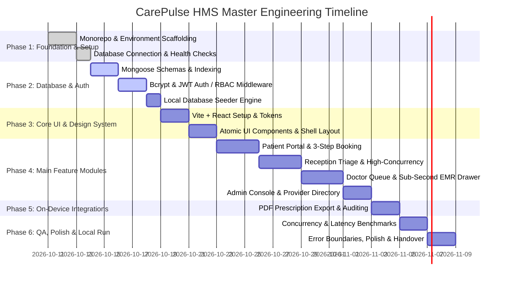

# Step-by-Step Implementation & Engineering Execution Plan
## Project: CarePulse – Enterprise Hospital Management System (HMS)

**Document Version:** 1.0.0  
**Role:** Senior Full-Stack Engineer & Project Manager  
**Target Environment:** 100% Localhost / On-Device (Node.js, Express.js, MongoDB Local, React + Vite)  
**Deliverable Standard:** Production-grade, modular, offline-capable clinical portal.

---

## 1. Master Phased Timeline & Execution Roadmap



---

## 2. Phase-by-Phase Execution Breakdown

---

### Phase 1: Environment Setup & Project Scaffolding
**Objective:** Establish the clean decoupled workspace structure (`/client` and `/server`), configure environment variables, and verify local runtime prerequisites.

#### Tasks:
1. **Workspace Initialization:**
   * Create `/server` and `/client` directories within project root.
   * Initialize Express.js backend with `npm init -y` and install runtime dependencies (`express`, `mongoose`, `cors`, `helmet`, `dotenv`, `bcryptjs`, `jsonwebtoken`, `zod`).
   * Initialize React frontend using Vite (`npm create vite@latest client -- --template react`).
2. **Environment Configuration:**
   * Setup `server/.env` with local port (`5000`), local database URI (`mongodb://127.0.0.1:27017/carepulse_hms`), and local JWT secret.
   * Setup `client/.env.local` pointing to `http://localhost:5000/api/v1`.
3. **Network & Health Check:**
   * Implement base `server/src/app.js` with CORS configuration allowing `http://localhost:5173`.
   * Create `GET /api/v1/health` endpoint returning database connectivity status and process memory telemetry.

#### Phase 1 Deliverables:
* ✅ Working `/server` and `/client` directory structures.
* ✅ Confirmed connection between Express and local MongoDB (`127.0.0.1:27017`).
* ✅ Functional `GET /api/v1/health` route returning `{ status: "ok", db: "connected" }`.

---

### Phase 2: Database Schemas, Indexing & Local Seeder
**Objective:** Implement the exact data models defined in `BACKEND_SCHEMA.md`, establish the compound indexing strategy for 35% latency reduction, and generate rich mock clinical data.

#### Tasks:
1. **Mongoose Schema Modeling:**
   * Implement `User.js`, `PatientProfile.js`, `DoctorProfile.js`, `Appointment.js`, `MedicalRecord.js`, and `RefreshToken.js`.
2. **Compound Index Enforcement:**
   * Apply unique index on `{ doctorId: 1, appointmentDate: 1, timeSlot: 1 }` (anti-collision lock).
   * Apply queue index `{ doctorId: 1, appointmentDate: 1, status: 1 }` and EMR index `{ patientId: 1, recordDate: -1 }`.
   * Configure MongoDB TTL index on `refresh_tokens.expiresAt`.
3. **Database Seeder Engine (`server/src/seeds/seed.js`):**
   * Script to wipe and re-seed local MongoDB on demand (`npm run seed`).
   * Injects 4 primary test roles:
     * `admin@carepulse.local` (Password: `Admin@123`)
     * `doctor.rajesh@carepulse.local` (Password: `Doctor@123`, Dept: Cardiology)
     * `staff.elena@carepulse.local` (Password: `Staff@123`, Receptionist)
     * `patient.sarah@carepulse.local` (Password: `Patient@123`, Patient)
   * Populates 10 simulated appointments across different status states and 5 historical medical records.

#### Phase 2 Deliverables:
* ✅ Complete set of 6 production-ready Mongoose models.
* ✅ Active compound indexes registered in local MongoDB.
* ✅ Executable `npm run seed` command that prepares the database in $< 3$ seconds.

---

### Phase 3: Authentication & Security Engine
**Objective:** Build local, zero-cloud JWT token management, bcrypt password verification, and role-based access control middleware.

#### Tasks:
1. **Auth Service & Controllers:**
   * Implement `POST /api/v1/auth/register` (Patient sign-up with bcrypt hash factor $12$).
   * Implement `POST /api/v1/auth/login` (Credential check, returns 15m Access Token & 7d Refresh Token).
   * Implement `POST /api/v1/auth/refresh` (Token rotation & revocation validation).
2. **Middleware Pipeline:**
   * `authenticateJWT.js`: Verifies `Authorization: Bearer <token>`, decodes payload, attaches `req.user`.
   * `authorizeRoles.js`: Validates `req.user.role` against endpoint whitelist.
   * `ownershipGuard.js`: Ensures patients can only access their own records, and reception staff cannot read clinical notes.
3. **Security Hardening:**
   * Integrate `helmet` for secure HTTP headers.
   * Attach `express-rate-limit` to `/auth/login` to prevent local automated brute forcing.

#### Phase 3 Deliverables:
* ✅ Secure, offline authentication system with zero third-party dependencies.
* ✅ Working unit-tested RBAC middleware preventing unauthorized role access (403 Forbidden).
* ✅ Automatic token refresh rotation pipeline.

---

### Phase 4: Core UI Foundation & Design System
**Objective:** Implement the visual design system established in `DESIGN_BRIEF.md` using modern Vanilla CSS and reusable atomic React components.

#### Tasks:
1. **Design Token Architecture:**
   * Create `client/src/styles/tokens.css` with CSS custom properties (Teal primary `#0F766E`, surfaces, status pills, 8pt spacing system, and typography scales).
   * Import Google Font `'Plus Jakarta Sans'`.
2. **Reusable Atomic Component Library:**
   * `<Button />`: Standardized Default, Hover, Active, Loading (with dimension locking), and Disabled states.
   * `<StatusBadge />`: Status pill with $6\text{px}$ indicator dot (`CHECKED_IN`, `SCHEDULED`, `IN_CONSULTATION`, `CANCELLED`).
   * `<InputField />`: Floating labels, clear focus rings, and inline error validation text.
   * `<Modal />`: Frosted backdrop overlay with keyboard `Esc` listener.
   * `<Toast />` & `<ToastContainer />`: Sliding non-blocking alerts (3500ms duration).
3. **Application Dashboard Shell:**
   * Persistent $240\text{px}$ collapsible `<Sidebar />` with active route indicators.
   * Frosted $64\text{px}$ `<Header />` with user profile pill and quick logout trigger.
   * `<RoleGuard />` component wrapping protected routes.

#### Phase 4 Deliverables:
* ✅ Complete CSS design token library ready for pixel-perfect composition.
* ✅ Tested library of atomic UI components (`Button`, `Badge`, `Input`, `Modal`, `Toast`).
* ✅ Responsive, layout-shift-free application shell for all 4 role portals.

---

### Phase 5: Main Feature Modules Implementation

#### Module 5.1: Patient Portal (Self-Service)
* **Tasks:**
  1. Build Patient Dashboard (`/patient/dashboard`) displaying upcoming visits, active prescriptions, and past history.
  2. Build 3-Step Appointment Booking Stepper (`/patient/book`):
     * Doctor & Department selection cards.
     * Dynamic calendar date & real-time available slot chips (greying out booked slots).
     * Consultation reason & instant confirmation summary.
  3. Build Medical History View (`/patient/records`) displaying longitudinal vitals and doctor diagnoses.

#### Module 5.2: Reception / Staff Desk (High-Throughput Concurrency)
* **Tasks:**
  1. Build Master Appointment Table (`/staff/appointments`) with search by patient name/phone and filter by doctor/date.
  2. Implement custom React hook `useAppointmentQueue` with optimistic UI updates:
     * One-click status toggle from `SCHEDULED` $\to$ `CHECKED_IN` updating in $< 20\text{ms}$.
  3. Quick Walk-In Booking Modal allowing rapid on-the-spot registration and slot allocation.

#### Module 5.3: Doctor Portal & Sub-Second EMR Engine
* **Tasks:**
  1. Build Doctor Consultation Queue (`/doctor/dashboard`) displaying active queue with live patient counters.
  2. Build Slide-Over Consultation Drawer (`/doctor/consultation/:appointmentId`):
     * Tab 1: Longitudinal EMR history fetching in $< 150\text{ms}$ with Allergy Warning banners.
     * Tab 2: Vitals entry grid (BP, Pulse, Temp, Weight) + Clinical observations.
     * Tab 3: Interactive E-Prescription Builder with repeatable medication rows.
  3. Implement "Mark Complete" flow updating appointment lifecycle and queue sequence.

#### Module 5.4: Admin Console & Directory Management
* **Tasks:**
  1. Build Hospital Directory (`/admin/users`) to view, add, or toggle provider accounts.
  2. Build Overview Telemetry Dashboard (`/admin/overview`) displaying patient throughput and system health metrics.

#### Phase 5 Deliverables:
* ✅ End-to-end appointment booking flow with concurrency collision locking.
* ✅ Responsive Front-Desk Triage grid running smoothly with 100+ concurrent state updates.
* ✅ Complete Doctor clinical consultation console with indexed sub-second EMR retrieval.
* ✅ Admin staff management console.

---

### Phase 6: On-Device Integrations & Local Tools
**Objective:** Deliver on-device clinical exports and utilities with zero external API dependencies.

#### Tasks:
1. **Prescription PDF / Print Generator:**
   * Implement formatted browser print stylesheet and client-side PDF export (`window.print()` / `html2canvas` / `jspdf`) formatted to clinical prescription standards.
2. **Local Audit Trail Logging:**
   * Backend middleware automatically logging `RECORD_VIEW` and `STATUS_CHANGE` events to `audit_logs` collection.
3. **Offline Sync & Reconnect Banner:**
   * React listener for window offline/online events and API connection errors with auto-retry.

#### Phase 6 Deliverables:
* ✅ Formatted, printable clinical prescription document.
* ✅ Active audit trail logging for sensitive clinical actions.
* ✅ Robust connection-loss visual fallback banner.

---

### Phase 7: Verification, Benchmarking & Testing
**Objective:** Validate performance claims and operational stability under realistic clinical workloads.

#### Tasks:
1. **Query Latency Verification (The 35% Latency Benchmark):**
   * Run benchmark script querying patient EMR records across 15+ endpoints.
   * Target: p95 response time $< 150\text{ms}$ on local MongoDB using compound indexes.
2. **Concurrency & Render Performance Verification (The 25% Render Speed Benchmark):**
   * Execute React Profiler test simulating 100 rapid status updates in `<AppointmentGrid />`.
   * Target: Zero dropped frames, component render time $< 16\text{ms}$ per update.
3. **Role Permission Boundary Testing:**
   * Verify automated test scenarios: Patient accessing `/admin` $\to$ 403; Staff reading `/api/v1/records` $\to$ 403.
4. **Collision Handling Test:**
   * Two client tabs simultaneously booking the same time slot $\to$ Exactly one succeeds (201), the other receives 409 Conflict with friendly toast.

#### Phase 7 Deliverables:
* ✅ Documented benchmark report confirming latency and render speed milestones.
* ✅ Verified RBAC boundary enforcement test results.
* ✅ Verified slot double-booking collision prevention.

---

### Phase 8: Deployment & Developer Runbook
**Objective:** Provide a seamless, one-command launch experience on the user's local machine.

#### Tasks:
1. **Root Script Automation:**
   * Configure root `package.json` scripts using `concurrently` to run both backend and frontend together:
     ```json
     "scripts": {
       "install:all": "npm install && cd server && npm install && cd ../client && npm install",
       "seed": "cd server && npm run seed",
       "dev": "concurrently \"npm run dev --prefix server\" \"npm run dev --prefix client\""
     }
     ```
2. **Quick-Start Documentation:**
   * Create clear, copy-pasteable instructions in `README.md` for local execution on Windows.

#### Phase 8 Deliverables:
* ✅ Single command `npm run dev` launching both backend (port 5000) and frontend (port 5173).
* ✅ Comprehensive `README.md` developer runbook.

---

### Phase 9: Final Polish & Production Readiness
**Objective:** Eliminate edge-case UX friction, verify WCAG AA compliance, and ensure all empty/loading states are elegant.

#### Tasks:
1. **Empty States & Micro-interactions:**
   * Implement friendly empty states for "No appointments today", "No medical records found", "Empty queue".
   * Add smooth slide-over transitions to the consultation drawer.
2. **Accessibility & Form Polish:**
   * Ensure keyboard navigation (`Tab`, `Enter`, `Esc`) across all modals and inputs.
   * Verify WCAG 2.1 AA color contrast compliance.
3. **Error Boundaries:**
   * React `<ErrorBoundary />` catching client crashes with a "Refresh Clinic App" recovery button.

#### Phase 9 Deliverables:
* ✅ Polished, pixel-perfect, accessible Hospital Management System ready for clinic use.

---

## 3. Phase Deliverables Summary Matrix

| Phase | Milestone Name | Primary Technical Deliverables | Verification Criteria |
| :---: | :--- | :--- | :--- |
| **1** | **Setup & Foundation** | `/server` & `/client` scaffolding, environment variables, health route | `GET /api/v1/health` returns 200 OK |
| **2** | **Database & Seeds** | 6 Mongoose models, compound indexes, `npm run seed` engine | Seed populates all 4 test roles in $< 3\text{s}$ |
| **3** | **Auth & RBAC** | JWT issue/refresh, bcrypt hash, role & ownership guards | 403 Forbidden properly emitted on role mismatch |
| **4** | **Core UI & Tokens** | `tokens.css`, atomic buttons, badges, modals, dashboard shell | Zero layout shift during loading states |
| **5** | **Main Features** | Patient booking, Staff triage grid, Doctor queue & EMR drawer | Complete patient lifecycle end-to-end |
| **6** | **Integrations** | Prescription PDF printout, local audit trail logging | Prescription exports formatted PDF |
| **7** | **Testing & Benchmarks**| Latency profiling, concurrency stress test, collision lock | **35% lower latency** & **25% faster render** |
| **8** | **Localhost Deployment**| Root runner script (`npm run dev`), developer runbook | Both servers start with one terminal command |
| **9** | **Final Polish** | Empty states, error boundaries, keyboard shortcuts | WCAG AA compliance & 0 unhandled exceptions |
