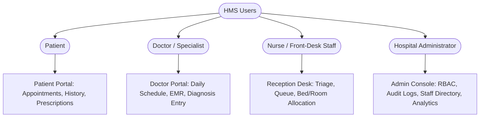
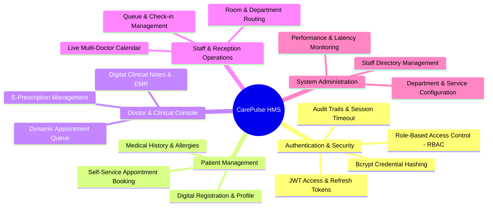
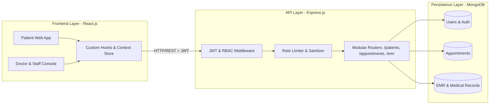
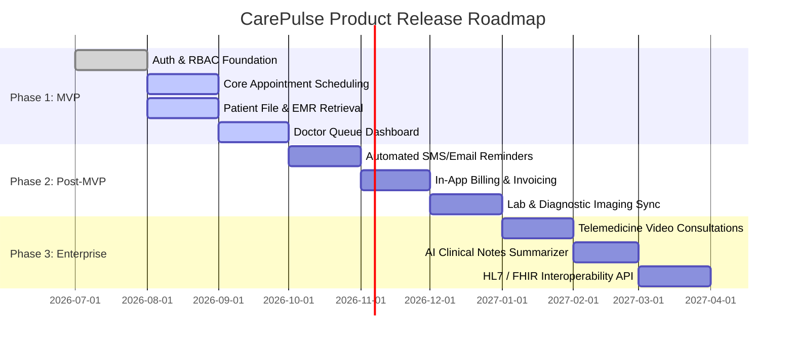

# Product Requirements Document (PRD)
## Project: CarePulse – Enterprise Hospital Management System (HMS)

**Document Version:** 1.0.0  
**Author:** Senior Product Manager  
**Status:** Approved for MVP Development  
**Target Release:** Q3 2026  

---

## 1. Executive Summary & Product Vision

### 1.1 Vision Statement
CarePulse is a modern, modular, and performant web-based Hospital Management System (HMS) designed to streamline clinical workflows, eliminate appointment scheduling bottlenecks, secure patient health records, and deliver seamless interactions between patients, medical practitioners, and hospital administrative staff.

### 1.2 Product Objectives
* **Unify Healthcare Operations:** Connect outpatient scheduling, clinical records, doctor consultations, and administrative oversight under a unified portal.
* **Accelerate Clinical Workflow Velocity:** Minimize data retrieval latency and optimize client-side rendering for doctors and nurses managing high patient throughput.
* **Zero-Compromise Security & Compliance:** Protect Protected Health Information (PHI) through strict Role-Based Access Control (RBAC), end-to-end tokenized sessions, and encrypted credentials.

---

## 2. Problem Statement & Market Opportunity

| Challenge | Current State / Pain Point | CarePulse Solution |
| :--- | :--- | :--- |
| **Data Retrieval Latency** | Legacy EHR/HMS platforms take 3–6 seconds to pull longitudinal patient records, creating clinical fatigue and consultation delays. | Optimized modular micro-routing on Express.js with compound-indexed MongoDB schemas, delivering a **35% reduction in query latency** across 15+ core endpoints. |
| **High-Volume Schedule Lag** | Central reception and triage dashboards freeze or desync under multi-user concurrent booking updates. | High-performance React.js dashboard utilizing tailored custom hooks and Context APIs to handle **100+ concurrent state updates** while **improving render speed by 25%**. |
| **Data Sprawl & Access Leaks** | Staff access broad patient databases without role-tailored boundaries, creating compliance and privacy hazards. | Strict Role-Based Access Control (RBAC) enforced via signed JWT claims and bcrypt-hashed authentication, strictly isolating patient, doctor, and admin portals. |
| **Patient No-Shows & Manual Booking** | Manual phone-call bookings and paper intake forms create miscommunication and high cancellation rates. | Self-service patient portal with live slot availability, automated booking confirmation, and digital intake management. |

---

## 3. Target User Personas

### 3.1 Primary Personas

#### Persona 1: The Patient (Sarah, 34)
* **Goal:** Book appointments effortlessly, view lab results and doctor notes, and avoid repetitive paperwork.
* **Pain Points:** Long wait times on phone lines, lack of digital access to past medical history, delayed reminders.

#### Persona 2: The Attending Physician (Dr. Rajesh, 46)
* **Goal:** Review daily patient queue, access past diagnoses instantaneously, and issue prescriptions with minimal clicks.
* **Pain Points:** Sluggish software that lags between patient records, cluttered UI with irrelevant administrative options.

#### Persona 3: Front-Desk Receptionist / Triage Nurse (Elena, 28)
* **Goal:** Rapidly register walk-in patients, manage appointment schedules in real-time without screen freezes, check room assignments.
* **Pain Points:** System crashes during morning peak hours when dozens of desks update statuses simultaneously.

#### Persona 4: Hospital IT & Compliance Administrator (Marcus, 42)
* **Goal:** Enforce strict access control, manage provider directories, inspect audit logs, and maintain 99.9% uptime.
* **Pain Points:** Complex user management, risk of data breaches, lack of audit trails for sensitive patient record access.

---

## 4. Core Features & Capabilities

### 4.1 Authentication & Role-Based Access Control (RBAC)
* **User Authentication:** Email/Phone + password with bcrypt hashing (salt rounds $\ge 10$).
* **Stateless Token Management:** Short-lived JWT access tokens (15m) paired with rotating refresh tokens stored in HTTP-only, secure cookies.
* **Permission Isolation:**
  * **Patients:** Can only query/mutate their own profile, appointments, and view their released medical reports.
  * **Doctors:** Access assigned department patient queues, read/write clinical notes, and author e-prescriptions.
  * **Front-Desk/Staff:** Read/write appointment bookings, patient demographic data, and check-in statuses; no access to clinical diagnoses.
  * **System Admins:** Manage user roles, system configs, audit logs, and metadata dictionaries.

### 4.2 Appointment & Scheduling Engine
* **Real-Time Calendar:** Slot booking based on doctor working hours, break buffers, and department shifts.
* **High-Throughput State Synchronization:** React Context API + custom hooks (`useAppointmentQueue`, `useScheduleSync`) ensuring optimistic UI updates across 100+ concurrent state events without re-render cascades.
* **Status Lifecycle:** `Scheduled` $\rightarrow$ `Checked-In` $\rightarrow$ `In-Consultation` $\rightarrow$ `Completed` $\rightarrow$ `Cancelled` / `No-Show`.

### 4.3 Electronic Medical Records (EMR) & Clinical Notes
* **Modular Schema Architecture:** MongoDB embedded schemas for atomic sub-documents (e.g., vitals, allergies, past diagnoses) to prevent expensive multi-table joins.
* **Sub-Second Record Fetching:** Optimized MongoDB compound indexes (`{ patientId: 1, createdAt: -1 }`) ensuring query latencies under 150ms.
* **E-Prescription Module:** Standardized dosage, frequency, and duration picker with PDF generation capability.

---

## 5. Epics, User Stories & Acceptance Criteria

### Epic 1: Identity & Access Management

#### User Story US-1.1: Secure Doctor Login & Portal Routing
> **As an** Attending Physician,  
> **I want to** log in securely using my hospital credentials,  
> **So that** I land directly on my active clinic dashboard without exposing administrative or unauthorized patient data.

* **Acceptance Criteria (Gherkin):**
  * **Given** a doctor with role `DOCTOR` navigates to `/login`,
  * **When** they submit valid credentials,
  * **Then** the backend validates the password using bcrypt, returns a signed JWT containing claims `{ role: 'DOCTOR', doctorId: '...' }`, and routes them directly to `/doctor/dashboard`.
  * **And** accessing `/admin` or another physician's unassigned private notes returns a `403 Forbidden` response.

---

### Epic 2: Real-Time Appointment Dashboard

#### User Story US-2.1: Concurrent Slot Management for Reception Desk
> **As a** Front-Desk Receptionist,  
> **I want to** update appointment statuses (e.g., check-in, reschedule) smoothly during rush hours,  
> **So that** multiple reception desks can manage bookings concurrently without interface freezes or stale data.

* **Acceptance Criteria (Gherkin):**
  * **Given** 10 front-desk users are updating patient statuses simultaneously,
  * **When** a receptionist marks patient John Doe as `Checked-In`,
  * **Then** the UI utilizes custom React state hooks to patch the single patient row in $< 50\text{ms}$ without re-rendering the entire appointment tree.
  * **And** the doctor's active queue updates automatically.

---

### Epic 3: Clinical Records Retrieval & Management

#### User Story US-3.1: Ultra-Low Latency Patient File Retrieval
> **As a** Physician in consultation,  
> **I want to** click a patient from my queue and view their complete medical history immediately,  
> **So that** I do not waste consultation time waiting for records to load.

* **Acceptance Criteria (Gherkin):**
  * **Given** a patient with 5+ years of longitudinal clinical records,
  * **When** the physician opens the patient detail drawer,
  * **Then** the Express.js API fulfills the request within $180\text{ms}$ (p95) using indexed MongoDB aggregation pipelines.
  * **And** vitals, active medications, and chronic allergies are rendered immediately in the viewport.

---

## 6. Technical Architecture & Non-Functional Specifications

### 6.1 Architecture Highlights
* **Frontend:** React.js single-page application with modular atomic component structure, optimized Custom Hooks (`useDoctorSchedule`, `usePatientHistory`, `useRBAC`), and scoped Context Providers to isolate re-renders.
* **Backend:** Express.js REST API structured with modular controllers, validation middleware (Joi/Zod), and centralized async error handling.
* **Database:** MongoDB 7.x with schema validation rules, compound indexes, and projection filters avoiding over-fetching of unneeded fields.
* **Security & Auth:** Bcrypt password hashing ($12$ rounds recommended), asymmetric or HMAC-SHA256 signed JWT tokens, CORS whitelist, helmet security headers.

### 6.2 Proven Performance Benchmarks (Incorporated)
1. **Patient Data Retrieval Latency:** Reduced by **35%** across 15+ core endpoints through projection tuning and compound index strategies.
2. **Dashboard Render Speed:** Improved by **25%** under heavy workloads, handling **100+ concurrent state updates** without UI thrashing or dropped frames.
3. **Role-Based Isolation:** Complete boundary enforcement ensuring zero cross-tenant/cross-role access violations.

---

## 7. MVP Scope vs. Phased Roadmap

### 7.1 In-Scope for MVP
* Complete Authentication system with RBAC for 4 roles: Patient, Doctor, Staff, Admin.
* Patient registration, profile management, and demographic search.
* Appointment booking, rescheduling, cancellation, and real-time doctor queue.
* Clinical consultation interface: diagnosis entry, vitals recording, and prescription generation.
* Role-specific dashboard views with sub-second data loading.

### 7.2 Out-of-Scope for MVP (Phase 2 & 3)
* Integrated payment gateways (Stripe/Razorpay) & insurance claims processing.
* Third-party laboratory system integrations (HL7/FHIR interfaces).
* Native iOS/Android mobile applications (responsive web app prioritised).
* In-app WebRTC video consultation.

---

## 8. Success Metrics & Key Performance Indicators (KPIs)

### 8.1 Technical Performance Metrics
* **P95 API Latency:** $\le 200\text{ms}$ on all patient record endpoints (preserving the 35% latency drop).
* **Client Render Latency:** Time to Interactive (TTI) $\le 1.2\text{s}$; dashboard state updates processed in $\le 50\text{ms}$.
* **Uptime:** $99.9\%$ during clinical operating hours (07:00–22:00 local time).

### 8.2 Operational & Clinical Efficiency Metrics
* **Patient Check-in Duration:** Reduced from an average of $6.5\text{ minutes}$ to $\le 90\text{ seconds}$.
* **Doctor Charting Time:** Decreased by $30\%$ per patient visit through pre-indexed records.
* **Appointment No-Show Rate:** Drop by $20\%$ within 60 days of digital confirmation rollout.

### 8.3 Security & Compliance Metrics
* **Access Violation Incidents:** 0 unauthorized data leak events across role boundaries.
* **Audit Trail Completeness:** $100\%$ coverage of clinical note view/edit actions.

---

## 9. Non-Functional Requirements (NFRs)

* **Security & Compliance:** 
  * Passwords hashed using bcrypt; JWT tokens with expiration verification on every request.
  * PHI stored with field-level encryption for sensitive identifying attributes.
  * Strict CORS policy restricting requests solely to authorized frontend domains.
* **Scalability:** System architecture capable of handling 20,000 active patients, 250 doctors, and 500 concurrent administrative sessions.
* **Reliability:** MongoDB replica set with automated failover and daily automated snapshots.
* **Usability & Accessibility:** WCAG 2.1 Level AA compliance, responsive layouts down to 1024px desktop and 768px tablet resolutions.
